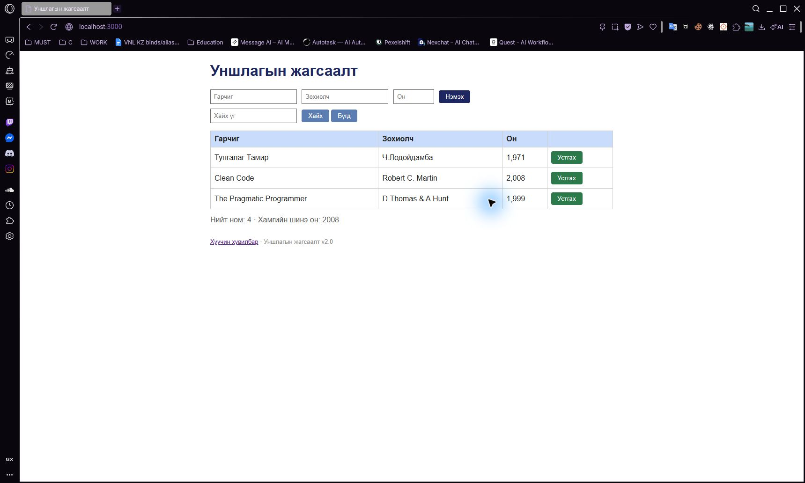

# BUG-01: Хүснэгтэд гурван ном байхад нийт тоолуур дөрөв гэж харуулдаг

Орчин: Уншлагын жагсаалт v2.0; Opera GX 136.0.6008.111 (нэмэлт давталт); анхны session: Chromium 155; Windows 11 Pro 10.0.26300; Node.js v24.19.0; 2026-10-19.

Урьдчилсан нөхцөл: өмнөх серверийг `Ctrl+C`-ээр зогсоож, `node app.js` гэж шинээр асаасан; анхны **3 номтой**. Зөвхөн хуудсаа Reload хийх нь өгөгдлийг анхны төлөвт оруулахгүй.

## Дахин гаргах алхам

1. Браузераар `http://localhost:3000/` хуудсыг нээнэ.
2. Хүснэгтийн номын мөрүүдийг тоолоод доорх «Нийт ном» утгатай харьцуулна.

**Хүлээгдэж байсан:** Спецификацийн «Нийт ном тоолуур хүснэгтэд буй номын тоотой тэнцүү» дүрмээр анхны гурван номд `Нийт ном: 3` харагдана.

**Бодит үр дүн:** Тунгалаг Тамир, Clean Code, The Pragmatic Programmer гэсэн гурван мөр байгаа ч `Нийт ном: 4` гэж харагдана.

**Ноцтой байдал:** Minor — Жагсаалтын хэмжээний мэдээлэл буруу боловч номын мөрүүдийг харах боломжтой.

**Олдсон аялал:** Supermodel — Tourist district.

## Нэмэлт баримт ба хяналт

Анхны гурван номыг нэг нэгээр нь устгаж шалгахад хоосон хүснэгт дээр ч `Нийт ном: 1` үлдсэн. Энэ нь тусдаа согог биш, ижил тоолуурын зөрүүний нэмэлт хувилбар. [Хоосон жагсаалтын API](../evidence/bug-01-empty-curl.txt), [түүний stats хариу](../evidence/bug-01-empty-stats-curl.txt).

## Дэлгэцийн нотолгоо

Opera GX дээр 2026-10-19-нд дахин гаргасан. [Давталтын хүрээ ба бүртгэл](../evidence/opera-gx/verification.md). [Анхны Chromium зураг](../screenshots/bug-01.jpg) мөн хадгалагдсан.

Oracle: багшийн Lab07 PDF-ийн 2-р хуудасны спецификаци; тусгайлан заасан хэсэгт ердийн хэрэглээний хүлээлт ашигласан.
