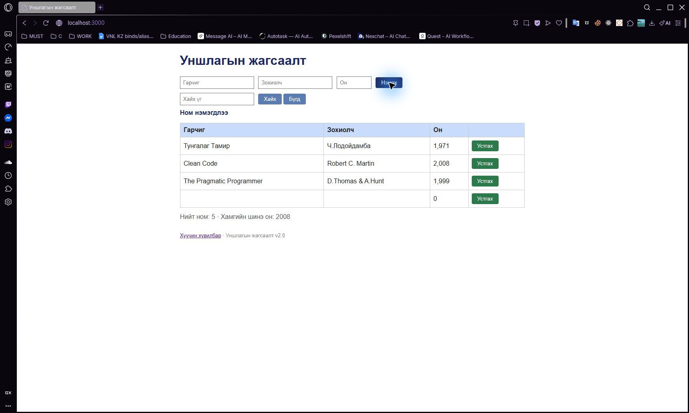

# BUG-04: Заавал бөглөх бүх талбар хоосон байхад ном нэмэгддэг

Орчин: Уншлагын жагсаалт v2.0; Opera GX 136.0.6008.111 (нэмэлт давталт); анхны session: Chromium 155; Windows 11 Pro 10.0.26300; Node.js v24.19.0; 2026-10-19.

Урьдчилсан нөхцөл: өмнөх серверийг `Ctrl+C`-ээр зогсоож, `node app.js` гэж шинээр асаасан; анхны **3 номтой**. Зөвхөн хуудсаа Reload хийх нь өгөгдлийг анхны төлөвт оруулахгүй.

## Дахин гаргах алхам

1. Браузераар `http://localhost:3000/` хуудсыг нээнэ.
2. Гарчиг, Зохиолч, Он талбаруудыг хоосон хэвээр үлдээнэ.
3. «Нэмэx» товчийг нэг удаа дарна.

**Хүлээгдэж байсан:** Гарчиг, зохиолч, он бүгд заавал бөглөгдөх ёстой тул ном нэмэгдэхгүй, ойлгомжтой алдааны мессеж харагдана. Анхны гурван мөр хэвээр байна.

**Бодит үр дүн:** Гарчиг, зохиолчгүй дөрөв дэх мөр нэмэгдэж, он нь `0` гэж харагдана. Алдааны оронд `Ном нэмэгдлээ` мессеж гарна.

**Ноцтой байдал:** Major — Дутуу өгөгдөл үндсэн жагсаалтад хадгалагдаж, амжилттай мэт мэдээлж байна.

**Олдсон аялал:** Couch Potato — Hotel district.

## Нэмэлт баримт ба хяналт

Гарчиг, зохиолч, оныг тус тус орхих API хувилбарууд мөн `201 Created` болсон. Эдгээрийг нэг required-field согогт нэгтгэсэн: [missing-title](../evidence/api-matrix/08-missing-title-post-curl.txt), [missing-author](../evidence/api-matrix/09-missing-author-post-curl.txt), [missing-year](../evidence/api-matrix/10-missing-year-post-curl.txt). UI туршилтын дараах өгөгдөл: [bug-04-books-curl.txt](../evidence/bug-04-books-curl.txt).

## Дэлгэцийн нотолгоо

Opera GX дээр 2026-10-19-нд дахин гаргасан. [Давталтын хүрээ ба бүртгэл](../evidence/opera-gx/verification.md). [Анхны Chromium зураг](../screenshots/bug-04.jpg) мөн хадгалагдсан.

Oracle: багшийн Lab07 PDF-ийн 2-р хуудасны спецификаци; тусгайлан заасан хэсэгт ердийн хэрэглээний хүлээлт ашигласан.
