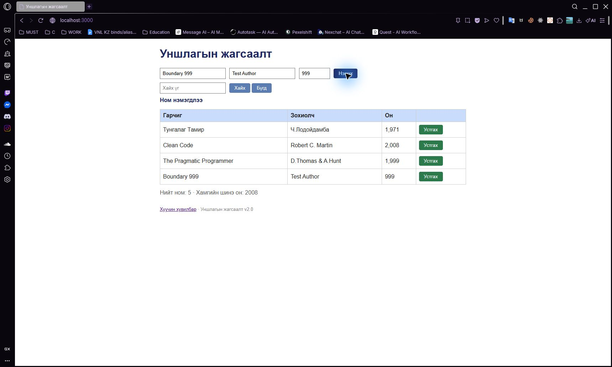

# BUG-05: 1000-аас бага онтой номыг зөвшөөрч хадгалдаг

Орчин: Уншлагын жагсаалт v2.0; Opera GX 136.0.6008.111 (нэмэлт давталт); анхны session: Chromium 155; Windows 11 Pro 10.0.26300; Node.js v24.19.0; 2026-10-19.

Урьдчилсан нөхцөл: өмнөх серверийг `Ctrl+C`-ээр зогсоож, `node app.js` гэж шинээр асаасан; анхны **3 номтой**. Зөвхөн хуудсаа Reload хийх нь өгөгдлийг анхны төлөвт оруулахгүй.

## Дахин гаргах алхам

1. Браузераар `http://localhost:3000/` хуудсыг нээнэ.
2. Гарчигт `Boundary 999`, Зохиолчид `Test Author`, Онд `999` оруулна.
3. «Нэмэx» товчийг нэг удаа дарна.

**Хүлээгдэж байсан:** Он 1000-2100 хоорондох бүхэл тоо байх дүрмээр `999`-ийг зөвшөөрөхгүй, ном нэмэхгүй, алдааг тайлбарлана.

**Бодит үр дүн:** `Boundary 999 / Test Author / 999` гэсэн дөрөв дэх мөр хадгалагдаж, `Ном нэмэгдлээ` гэж гарна.

**Ноцтой байдал:** Major — Номын үндсэн өгөгдлийн тоон хязгаар болон бүхэл тооны шаардлага шалгагдахгүй байна.

**Олдсон аялал:** Fed-Ex — Business district.

## Нэмэлт баримт ба хяналт

Ижил оны шалгалтын хүрээнд `2101`, `1999.5`, `abc`, `-1` мөн хадгалагдсан. `abc` UI дээр `NaN`, `1999.5` нь `1,999.5` болсон. Эдгээрийг нэмэлт согог болгон тоолоогүй. Харин зөв заагийн `1000`, `2100` нэмэгдсэн. Хүсэлт, хариу нь [API матриц](../evidence/api-matrix/results.json)-д, нэмэлт зураг нь [бутархай он](../screenshots/bug-05-decimal.jpg), [текстэн он](../screenshots/bug-05-text-year.jpg)-д бий.

## Дэлгэцийн нотолгоо

Opera GX дээр 2026-10-19-нд дахин гаргасан. [Давталтын хүрээ ба бүртгэл](../evidence/opera-gx/verification.md). [Анхны Chromium зураг](../screenshots/bug-05.jpg) мөн хадгалагдсан.

Oracle: багшийн Lab07 PDF-ийн 2-р хуудасны спецификаци; тусгайлан заасан хэсэгт ердийн хэрэглээний хүлээлт ашигласан.
