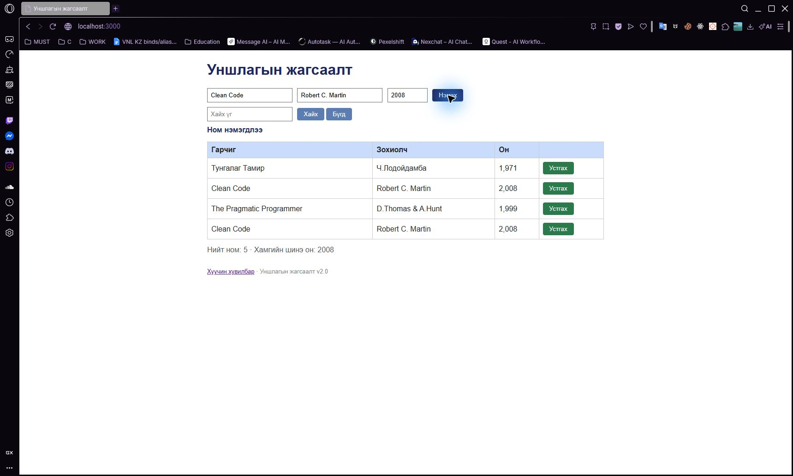

# BUG-06: Ижил гарчиг, зохиолчтой ном дахин нэмэгддэг

Орчин: Уншлагын жагсаалт v2.0; Opera GX 136.0.6008.111 (нэмэлт давталт); анхны session: Chromium 155; Windows 11 Pro 10.0.26300; Node.js v24.19.0; 2026-10-19.

Урьдчилсан нөхцөл: өмнөх серверийг `Ctrl+C`-ээр зогсоож, `node app.js` гэж шинээр асаасан; анхны **3 номтой**. Зөвхөн хуудсаа Reload хийх нь өгөгдлийг анхны төлөвт оруулахгүй.

## Дахин гаргах алхам

1. Браузераар `http://localhost:3000/` хуудсыг нээнэ.
2. Гарчигт `Clean Code`, Зохиолчид `Robert C. Martin`, Онд `2008` оруулна.
3. «Нэмэx» товчийг нэг удаа дарна.

**Хүлээгдэж байсан:** Анхны жагсаалтад энэ гарчиг, зохиолчтой ном байгаа учраас давхар нэмэгдэхгүй. Хүснэгт гурван номтой хэвээр байна.

**Бодит үр дүн:** `Clean Code / Robert C. Martin / 2,008` гэсэн ижил хоёр мөр болж, нийт дөрвөн ном хадгалагдана. `Ном нэмэгдлээ` мессеж гарна.

**Ноцтой байдал:** Major — Давхардал хориглох үндсэн дүрэм зөрчигдөж, нэг номын бүртгэл олширч байна.

**Олдсон аялал:** Fed-Ex — Business district.

## Нэмэлт баримт ба хяналт

API-аар яг ижил хосыг нэмэхэд мөн [201 Created](../evidence/api-matrix/13-duplicate-exact-post-curl.txt) болсон. Ижил гарчигтай боловч өөр зохиолчтой ном, өөр гарчигтай боловч ижил зохиолчтой номыг зөв хяналт болгон тусад нь нэмсэн; тэр хоёр тохиолдлыг давхардлын согог гэж үзээгүй.

## Дэлгэцийн нотолгоо

Opera GX дээр 2026-10-19-нд дахин гаргасан. [Давталтын хүрээ ба бүртгэл](../evidence/opera-gx/verification.md). [Анхны Chromium зураг](../screenshots/bug-06.jpg) мөн хадгалагдсан.

Oracle: багшийн Lab07 PDF-ийн 2-р хуудасны спецификаци; тусгайлан заасан хэсэгт ердийн хэрэглээний хүлээлт ашигласан.
