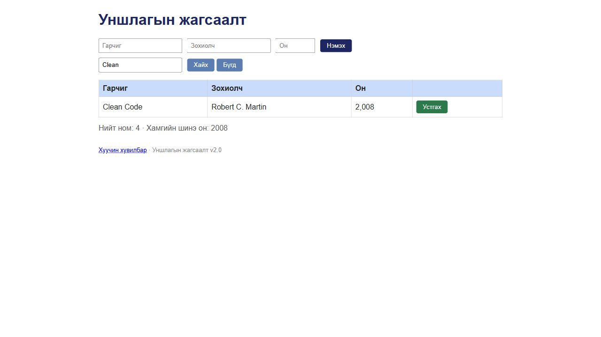
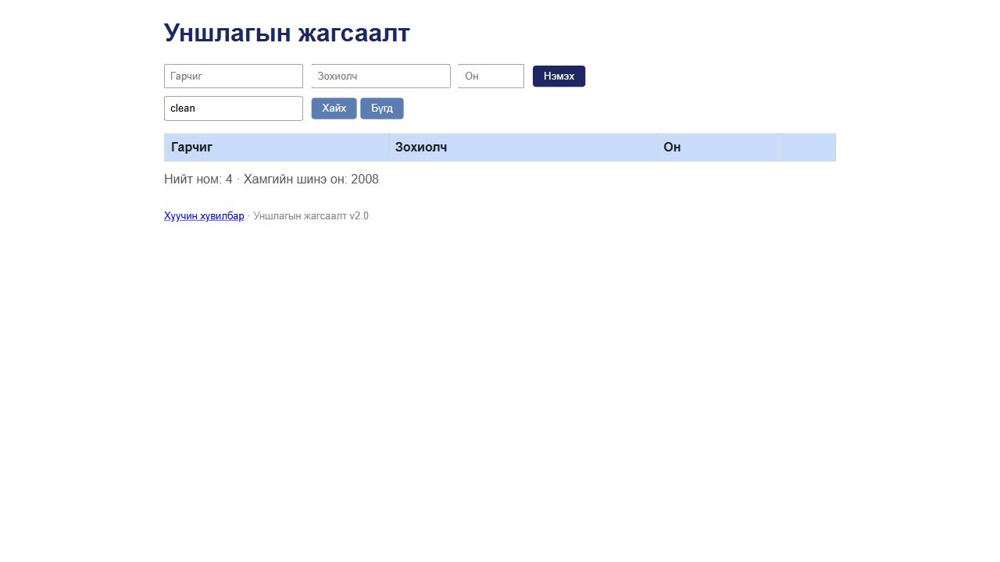

# BUG-07: Хайлт том, жижиг үсгийг ялгаж ижил номыг олохгүй болдог

Орчин: Уншлагын жагсаалт v2.0; Codex in-app browser, Chromium 155 (хүсэлтийн User-Agent: Chrome/155.0.0.0); Windows 11 Pro 10.0.26300; Node.js v24.19.0; 2026-10-19.

Урьдчилсан нөхцөл: өмнөх серверийг `Ctrl+C`-ээр зогсоож, `node app.js` гэж шинээр асаасан; анхны **3 номтой**. Зөвхөн хуудсаа Reload хийх нь өгөгдлийг анхны төлөвт оруулахгүй.

## Дахин гаргах алхам

1. Браузераар `http://localhost:3000/` хуудсыг нээнэ.
2. «Хайх үг» талбарт `Clean` оруулаад «Хайх» дарна; нэг ном олдохыг ажиглана.
3. Тэр талбарыг `clean` болгон солиод «Хайх» дахин дарна.

**Хүлээгдэж байсан:** Хайлт гарчиг болон зохиолчоос том/жижиг үсэг ялгахгүй хайх ёстой. `Clean` ба `clean` хоёулаа Clean Code номыг олно.

**Бодит үр дүн:** `Clean` нь нэг мөр олдог боловч `clean` нь хоосон хүснэгт харуулдаг.

**Ноцтой байдал:** Major — Үндсэн хайлтын үйлдэл шаардсан ижил утгатай оролтод өөр үр дүн гаргаж байна.

**Олдсон аялал:** Fed-Ex — Business district.

## Нэмэлт баримт ба хяналт

Зохиолчийн `Robert` / `robert`, кирилл гарчгийн `Тунгалаг` / `тунгалаг` дээр ижил ялгаа давтагдсан. Эдгээр нь нэг хайлтын согогийн хувилбарууд.

## Дэлгэцийн нотолгоо

Oracle: багшийн Lab07 PDF-ийн 2-р хуудасны спецификаци; тусгайлан заасан хэсэгт ердийн хэрэглээний хүлээлт ашигласан.
