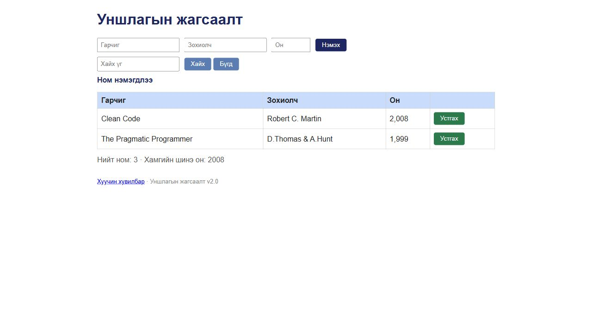

# BUG-08: Ном устгасны дараа нэмэгдсэн гэсэн мессеж гардаг

Орчин: Уншлагын жагсаалт v2.0; Codex in-app browser, Chromium 155 (хүсэлтийн User-Agent: Chrome/155.0.0.0); Windows 11 Pro 10.0.26300; Node.js v24.19.0; 2026-10-19.

Урьдчилсан нөхцөл: өмнөх серверийг `Ctrl+C`-ээр зогсоож, `node app.js` гэж шинээр асаасан; анхны **3 номтой**. Зөвхөн хуудсаа Reload хийх нь өгөгдлийг анхны төлөвт оруулахгүй.

## Дахин гаргах алхам

1. Браузераар `http://localhost:3000/` хуудсыг нээнэ.
2. «Тунгалаг Тамир» мөрийн «Устгах» товчийг нэг удаа дарна.
3. Жагсаалтын дээд хэсгийн үйлдлийн мессежийг уншина.

**Хүлээгдэж байсан:** Ном устгагдсаныг илэрхийлсэн мессеж харагдана. Спецификацийн дагуу мессеж нь тухайн үйлдэлдээ тохирох ёстой.

**Бодит үр дүн:** Тунгалаг Тамир мөр алга болж хоёр ном үлдсэн ч мессеж нь `Ном нэмэгдлээ` байна.

**Ноцтой байдал:** Minor — Үйлдэл хийгдсэн боловч эсрэг утгатай мэдэгдэл өгч, хэрэглэгчийг төөрөгдүүлж байна.

**Олдсон аялал:** Fed-Ex — Business district.

## Дэлгэцийн нотолгоо

Oracle: багшийн Lab07 PDF-ийн 2-р хуудасны спецификаци; тусгайлан заасан хэсэгт ердийн хэрэглээний хүлээлт ашигласан.
