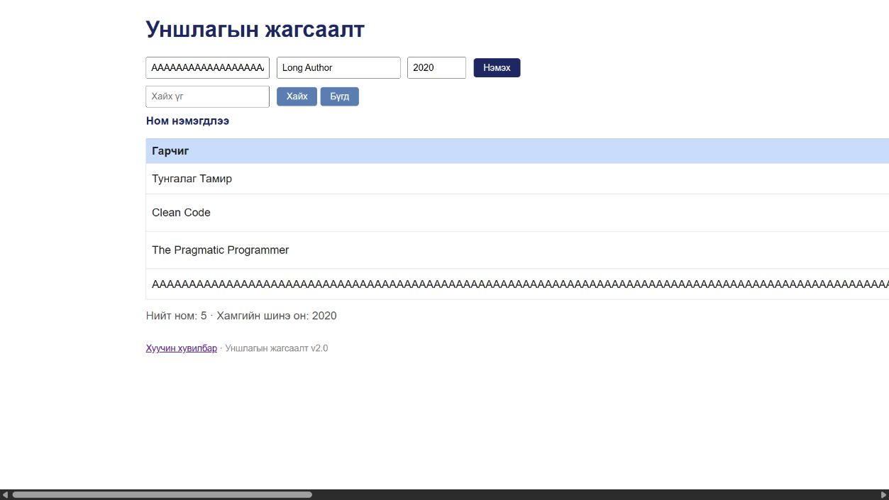

# BUG-11: Зайгүй урт гарчиг хүснэгтийг дэлгэцээс хальтал сунгадаг

Орчин: Уншлагын жагсаалт v2.0; Codex in-app browser, Chromium 155 (хүсэлтийн User-Agent: Chrome/155.0.0.0); Windows 11 Pro 10.0.26300; Node.js v24.19.0; 2026-10-19.

Урьдчилсан нөхцөл: өмнөх серверийг `Ctrl+C`-ээр зогсоож, `node app.js` гэж шинээр асаасан; анхны **3 номтой**. Зөвхөн хуудсаа Reload хийх нь өгөгдлийг анхны төлөвт оруулахгүй.

## Дахин гаргах алхам

1. Браузерийн харах хэсгийг 1280 × 720 орчим болгож `http://localhost:3000/` хуудсыг нээнэ.
2. Гарчигт доорх 300 ширхэг залгаа `A` үсгийг хуулна.
3. Зохиолчид `Long Author`, Онд `2020` оруулаад «Нэмэx» дарна.
4. Хүснэгтийн баганууд дэлгэцдээ багтаж байгаа эсэхийг харна.

**Хүлээгдэж байсан:** Спецификацийн дагуу ямар ч урттай оролт хүснэгтийг эвдэхгүй. Урт текст мөрөө нугалах зэрэг аргаар бусад баганыг ашиглах боломжтой байлгана.

**Бодит үр дүн:** 1280px харах хэсэгт хүснэгтийн өргөн ойролцоогоор 3484px болсон. Зохиолч, он, устгах баганууд баруун тийш хальж, хэвтээ гүйлгэхгүйгээр харагдахгүй байна.

**Ноцтой байдал:** Minor — Жагсаалтыг ердийн байдлаар унших, мөрийн үйлдэлд хүрэхэд хүндрэл үүсгэнэ; хэвтээ гүйлгэх боломж үлдсэн.

**Олдсон аялал:** Supermodel — Tourist district.

## Нэмэлт баримт ба хяналт

```text
AAAAAAAAAAAAAAAAAAAAAAAAAAAAAAAAAAAAAAAAAAAAAAAAAAAAAAAAAAAAAAAAAAAAAAAAAAAAAAAAAAAAAAAAAAAAAAAAAAAAAAAAAAAAAAAAAAAAAAAAAAAAAAAAAAAAAAAAAAAAAAAAAAAAAAAAAAAAAAAAAAAAAAAAAAAAAAAAAAAAAAAAAAAAAAAAAAAAAAAAAAAAAAAAAAAAAAAAAAAAAAAAAAAAAAAAAAAAAAAAAAAAAAAAAAAAAAAAAAAAAAAAAAAAAAAAAAAAAAAAAAAAAAAAAAAAAAAAAAAA
```

Зайтай урт гарчгийн хяналтад хүснэгт 860px хэвээр байсан: [хяналтын зураг](../screenshots/bug-11-spaced-control.jpg). Зохиолчид 300 залгаа `B` оруулахад мөн хальсан; үүнийг тусдаа согог болгож тоолоогүй.

## Дэлгэцийн нотолгоо



Oracle: багшийн Lab07 PDF-ийн 2-р хуудасны спецификаци; тусгайлан заасан хэсэгт ердийн хэрэглээний хүлээлт ашигласан.
