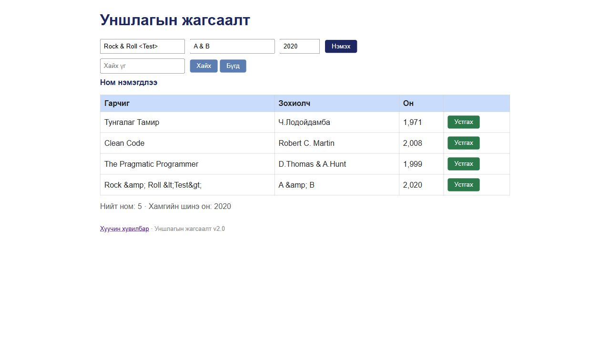
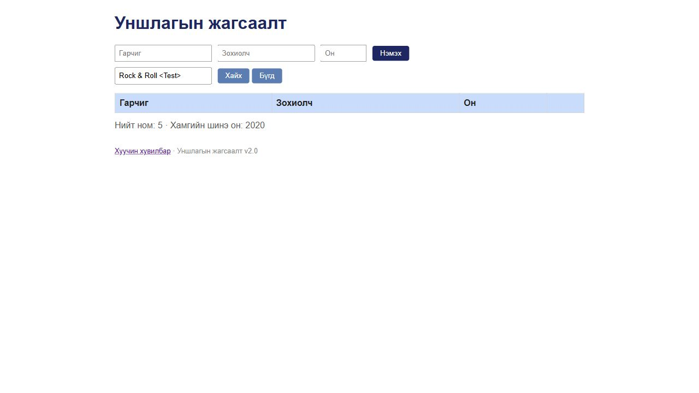

# BUG-12: Шинэ номын тусгай тэмдэгтүүд entity текст болон хадгалагддаг

Орчин: Уншлагын жагсаалт v2.0; Codex in-app browser, Chromium 155 (хүсэлтийн User-Agent: Chrome/155.0.0.0); Windows 11 Pro 10.0.26300; Node.js v24.19.0; 2026-10-19.

Урьдчилсан нөхцөл: өмнөх серверийг `Ctrl+C`-ээр зогсоож, `node app.js` гэж шинээр асаасан; анхны **3 номтой**. Зөвхөн хуудсаа Reload хийх нь өгөгдлийг анхны төлөвт оруулахгүй.

## Дахин гаргах алхам

1. Браузераар `http://localhost:3000/` хуудсыг нээнэ.
2. Гарчигт `Rock & Roll <Test>`, Зохиолчид `A & B`, Онд `2020` оруулна.
3. «Нэмэx» дарж шинэ мөрийн текстийг оруулсан утгатай харьцуулна.
4. «Хайх үг» талбарт `Rock & Roll <Test>` оруулаад «Хайх» дарна.

**Хүлээгдэж байсан:** Хэрэглэгчийн оруулсан гарчиг, зохиолч утгаа алдалгүй хадгалагдаж харагдана. Хайлтын дүрмийн дагуу яг оруулсан гарчгаар шинэ ном олдоно. Энэ нь өгөгдөл өөрчлөгдөхгүй байх ердийн хүлээлт болон хайлтын спецификацид тулгуурласан.

**Бодит үр дүн:** Хүснэгтэд `Rock &amp; Roll &lt;Test&gt;`, `A &amp; B` гэж харагдана. API GET мөн эдгээр entity текстийг буцаадаг. Анхны `Rock & Roll <Test>` бичвэрээр хайхад 0 мөр; entity текстээр хайхад ном олдсон.

**Ноцтой байдал:** Major — Оруулсан өгөгдөл өөрчлөгдөж, тухайн нэрээр нь хайх боломж алдагдана.

**Олдсон аялал:** Fed-Ex — Business district.

## Нэмэлт баримт ба хяналт

Хадгалсан өгөгдөл: [bug-12-books-curl.txt](../evidence/bug-12-books-curl.txt). Анхны өгөгдөл дэх `D.Thomas & A.Hunt` хэвийн харагдаж, хайгдсан тул согогийг шинээр нэмсэн өгөгдлийн замаар тодорхойлсон.

## Дэлгэцийн нотолгоо

Oracle: багшийн Lab07 PDF-ийн 2-р хуудасны спецификаци; тусгайлан заасан хэсэгт ердийн хэрэглээний хүлээлт ашигласан.
