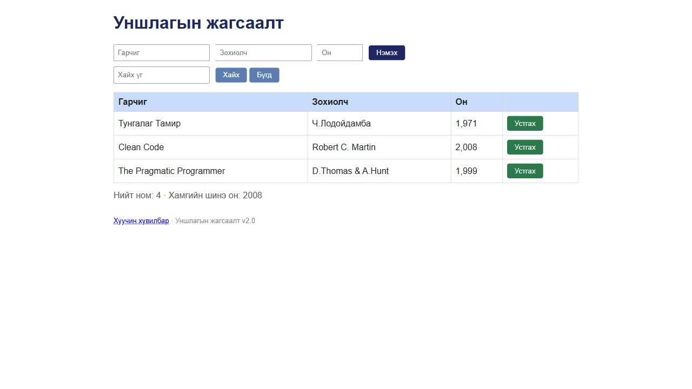

# BUG-14: Нэмэх товчны сүүлийн үсэг кирилл х-ийн оронд латин x байна

Орчин: Уншлагын жагсаалт v2.0; Codex in-app browser, Chromium 155 (хүсэлтийн User-Agent: Chrome/155.0.0.0); Windows 11 Pro 10.0.26300; Node.js v24.19.0; 2026-10-19.

Урьдчилсан нөхцөл: өмнөх серверийг `Ctrl+C`-ээр зогсоож, `node app.js` гэж шинээр асаасан; анхны **3 номтой**. Зөвхөн хуудсаа Reload хийх нь өгөгдлийг анхны төлөвт оруулахгүй.

## Дахин гаргах алхам

1. Браузераар `http://localhost:3000/` хуудсыг нээнэ.
2. Нэмэх товчны текстийг шалгана; дүрс нь төстэй тул Developer Tools-ийн Console-д доорх DOM текст унших командыг ажиллуулна.
3. Сүүлийн тэмдэгтийн Unicode кодыг шалгана.

**Хүлээгдэж байсан:** Спецификацийн текстүүд үсгийн алдаагүй байх дүрмээр товч `Нэмэх` гэж кирилл үсгээр бичигдэнэ. Сүүлийн `х` нь `U+0445` байна.

**Бодит үр дүн:** Товчны бодит текст `Нэмэx`; сүүлийн тэмдэг нь `U+0078` буюу Latin `x` байна. Кодын дараалал `U+041D U+044D U+043C U+044D U+0078`.

**Ноцтой байдал:** Cosmetic — Товчны үйлдэл ажилладаг боловч Монгол бичвэр дотор латин үсэг орсон. Харагдах дүрс нь төстэй учраас зураг дангаараа хангалттай нотолгоо болохгүй.

**Олдсон аялал:** Supermodel — Tourist district.

## Нэмэлт баримт ба хяналт

```javascript
Array.from(document.querySelector("button").textContent, c =>
  "U+" + c.codePointAt(0).toString(16).toUpperCase().padStart(4, "0")
)
```

Ажигласан текст болон кодууд: [bug-14-label.json](../evidence/bug-14-label.json). Энэ нь UI-ийн DOM текстийн шалгалт бөгөөд аппын JavaScript эх кодыг унших алхам биш.

## Дэлгэцийн нотолгоо



Oracle: багшийн Lab07 PDF-ийн 2-р хуудасны спецификаци; тусгайлан заасан хэсэгт ердийн хэрэглээний хүлээлт ашигласан.
